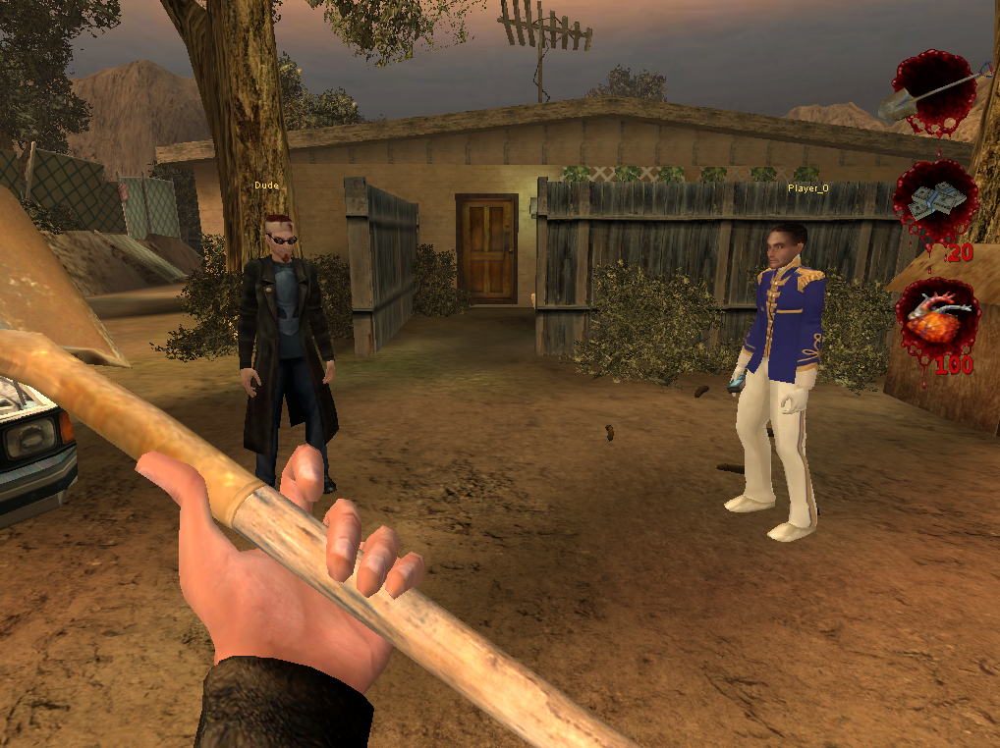

# POSTAL 2 LAN Coop

Play the POSTAL 2 campaign with a friend over LAN.

The goal is to explore Paradise together, complete errands, keep your own inventory,
and move between areas as a group. The planned campaign covers **Monday to Friday
and Apocalypse Weekend**. Paradise Lost is not included for now.

> **Early development:** this is a testing project, not a finished coop campaign.
> No complete campaign day has been fully tested with two players yet.

## Built-in multiplayer menu

Host a game, find a LAN session and join your friends through the in-game
**Multiplayer** menu. The host menu includes difficulty selection, player/spectator limits and a skip-intro
option, while **Player Change** lets you choose your name and character.

Character changes still have a known bug: another player may see the new body
without its head until the changed character jumps. The update should appear
immediately; this is on the fix list below.

## Can we play it yet?

Two players can join, see each other, use their inventories and travel between
areas. However, several parts of the campaign still behave incorrectly. Expect
bugs and unfinished features, especially around police, NPCs and cutscenes.

| Feature | Current state |
| --- | --- |
| Two players in one world | Working in local tests; testing on two separate LAN PCs is still needed |
| Separate player inventories | Working in tested cases; broader testing is ongoing |
| Travelling between areas together | Working in tested cases, with remaining bugs being fixed |
| Host / join menu and LAN search | Available; still being tested |
| Completing errands together | Partly working |
| Shared cutscenes | Partly working; dialogue, subtitles and skipping have problems |
| Police and wanted levels | Per-player fix added; server checks passed, confirmation on two LAN PCs still needed |
| NPCs and dogs | Known bugs: they can choose the wrong player to attack |
| Saving, loading and autosave | Not available yet |

The next experimental build adds a client map, owner-only pickup sounds,
remote urine visuals and reconnect inventory recovery for the same running
campaign. Server checks have passed; two-PC presentation and reconnect testing
are still needed. Reconnect recovery does not save the campaign when the host
quits. Coop launchers preserve your saved graphics and control settings.

It also hands the day's errands out the way the original campaign does. When
a day opens, both players get the map with the Dude writing the day's chores
on it, and when either player finishes one, both see it crossed off. Before
this, no day was ever opened, so the original start-of-day scripts never ran
and the map stayed blank for both players.

## To do

- [ ] Finish spectator mode.
- [ ] Add cheat mode.
- [ ] Add admin access.
- [ ] Fix character changes so both the body and head update immediately for other players, without needing to jump.

## Download

**There is no public playable release yet.** Downloadable test builds will be
listed in [Releases](https://github.com/honzacies/Postal2Multiplayer/releases)
when they are ready to share.

GitHub's **Code → Download ZIP** downloads the project source, not an installable mod.
You will need your own copy of POSTAL 2 Complete; the game is not included.

## How test builds are installed

When a test ZIP is available:

1. Use a separate, clean copy of POSTAL 2 Complete.
2. Extract the mod ZIP into the game folder — the folder containing `System`.
3. Start the game using the included `Start-LanCoop-*` launchers.

Nick's Coop does not need to be installed. Each player needs the same game version
and the same version of this mod. The current build has been tested with POSTAL 2
build 5100, dated April 17, 2023. Compatibility with other versions is unverified.

## Playing with a friend

- **Host:** run `Start-LanCoop-Host.cmd`.
- **Friend:** run `Start-LanCoop-Menu.cmd`, then choose **Multiplayer → Join Game**.
- Select the LAN game. Leave **Join as spectator** unchecked to play.
- If discovery does not find the host, enter the host's LAN address and port.
  The included Host launcher uses port **7787**.

Testing two instances on one PC is also supported, without a VM:
start Host first, then `Start-LanCoop-Client.cmd`.

These instructions describe the current experimental test package. Some features
may change before a public release. Do not expect a reliable full campaign yet.

## Campaign testing

✅ = verified end-to-end in coop. ❌ = not yet verified or still has known issues.
A successful pickup or automated check alone does not count as a completed mission.

### Monday

- Pick up Paycheck ❌ — pickup tested; protestor targeting and cutscene behavior still have issues.
- Cash Paycheck ❌
- Buy Milk ❌

### Tuesday

- Confess Sins ❌
- Get Signatures ❌
- Return Book ❌
- Get Gary's Autograph ❌

### Wednesday

- Piss on Dad's Grave ❌
- Vote ❌
- Get a Christmas Tree ❌
- Pick up Laundry ❌

### Thursday

- Get Napalm ❌
- Get Krotchy ❌
- Get Steaks ❌
- Pay Ticket ❌

### Friday

- Get Alternator ❌
- Pick up Package ❌
- Give Uncle Dave's Birthday Present ❌
- Visit Clinic ❌

### Saturday — Apocalypse Weekend

- Kill Phraud ❌
- Remaining story objectives ❌ — the individual story checklist is still being documented.

### Sunday — Apocalypse Weekend

- Story objectives and final encounters ❌ — the individual story checklist is still being documented.

Apocalypse Weekend uses scripted story progression rather than the weekday errand
list; its detailed checklist has not been completed yet. **No full day is verified.**

## Found a bug?

[Open a bug report](https://github.com/honzacies/Postal2Multiplayer/issues/new/choose)
and tell us:

- Which day and area you were in.
- Whether the host or the joining player performed the action.
- What you did, what you expected, and what happened instead.
- Whether it happened after travelling or skipping a cutscene.

Screenshots and a short log excerpt help. Logs are in the game's `System` folder:
`LanCoopHost.log`, `LanCoopMenu.log` or `LanCoopClient.log`, depending on which
launcher was used. [More about logs](DEBUGGING.md).

## For contributors

Start with the [code map](docs/CODE-MAP.md): where everything lives, how the
original campaign hands out work, and the engine rules that bite. The detailed
[test ledger](TESTING.md), [development guide](docs/DEVELOPMENT.md) and
[implementation notes](ARCHITECTURE.md) track the work behind the mod.
Contributions to the original game, including its base multiplayer fixes, are
acknowledged in [CREDITS.md](CREDITS.md).

This is an unofficial project. POSTAL 2 and Unreal Engine belong to their
respective owners. No game files or original developer source dump are included.
